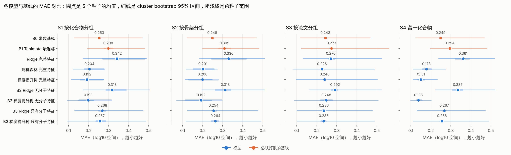
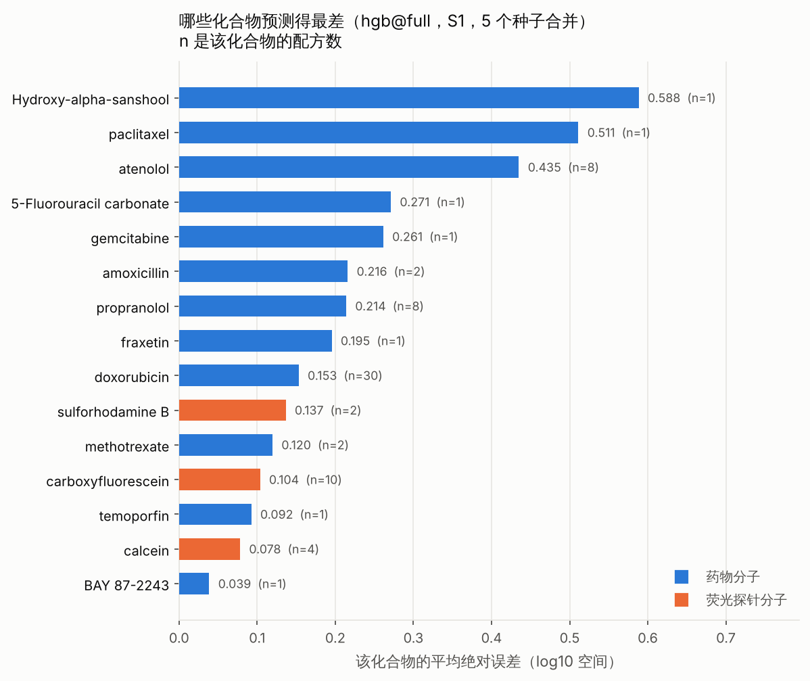
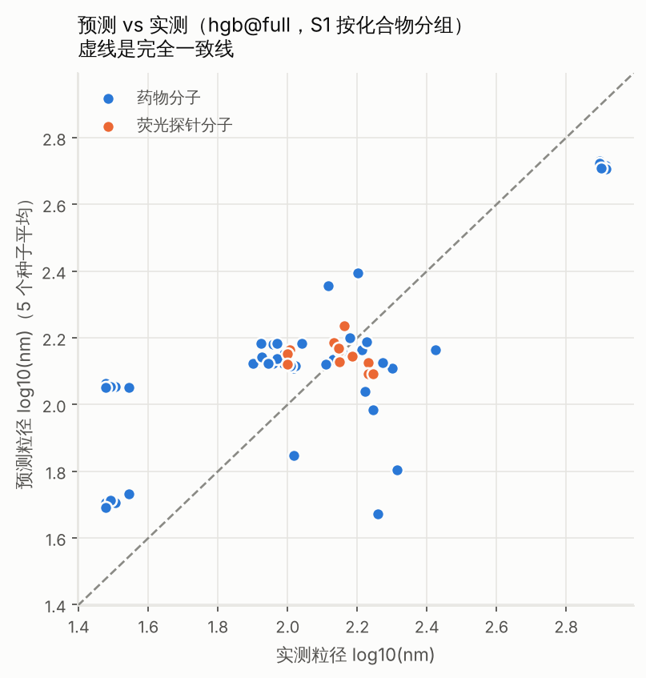
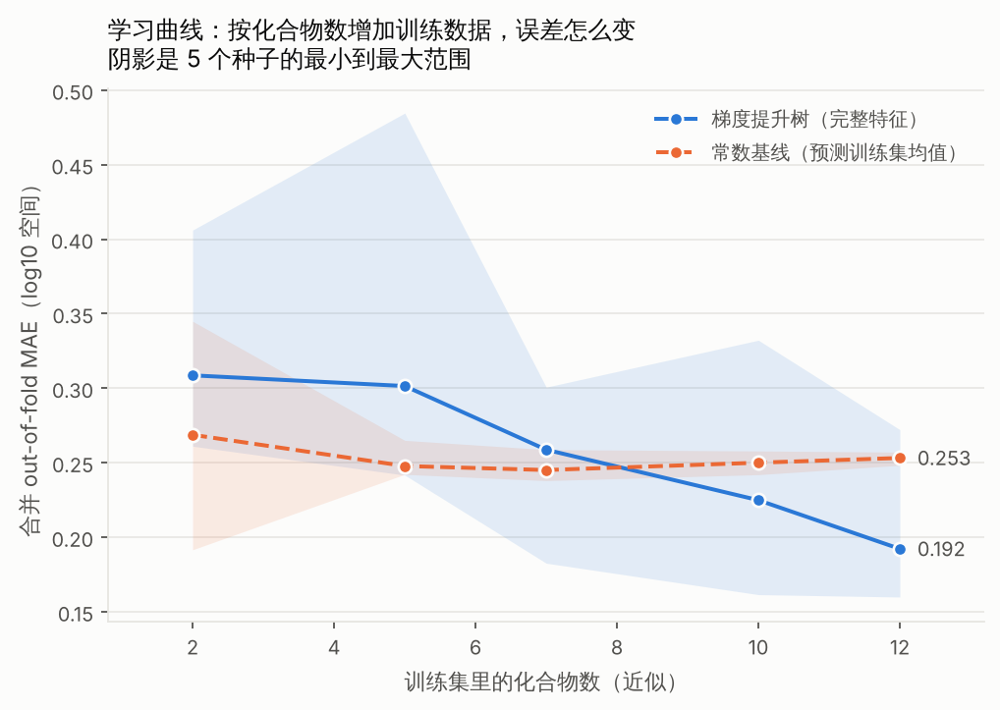
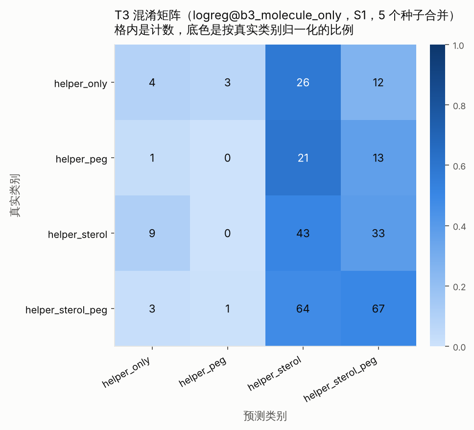

# 小分子基线（2026-10-19 起跑，2026-10-20 完成）

**一句话结论：以现有小分子数据，建不出比「永远预测训练集均值」更可靠的粒径模型。按协议第十节事先写死的标准，这一轮判定为「不成功」。**

这个结论本身是这一轮的主要产出：它告诉我们下一步该补什么数据，以及补多少。

---

## 〇、怎么复现

```bash
python3 scripts/build_features.py  --config configs/smallmol_baseline.yaml
python3 scripts/run_modeling.py    --config configs/smallmol_baseline.yaml --out modeling/2026-10-19_smallmol-baseline
python3 scripts/render_tables.py   --dir   modeling/2026-10-19_smallmol-baseline
python3 scripts/make_figures.py    --dir   modeling/2026-10-19_smallmol-baseline
```

| 文件 | 内容 |
|---|---|
| `config_used.yaml` | 本次用的全部配置（子集定义、指纹位数、种子、禁止字段清单） |
| `metrics.json` | 全部指标，含每个种子的逐个数值、置信区间、最优超参 |
| `results_tables.md` | 结果表，由 `scripts/render_tables.py` 从 `metrics.json` 生成，不是手抄 |
| `learning_curve.csv` | 学习曲线原始数据 |
| `oof_predictions_t1_S1-S2-S3.csv` / `_t2` / `_t3_*` | 逐条 out-of-fold 预测，供误差分析复查 |
| `feature_manifest.json` | 特征分块清单与缺失率 |
| `figures/` | 5 张图 |

**评估协议**：`docs/evaluation-protocol.md`，建模前已冻结（2026-10-19），期间只改过一次（新增 T3 探针任务），改动在跑任何模型之前、单独一次提交、原因写在协议第十二节。T1 和 T2 的定义、指标、划分、基线、成功标准全程未改。

**运行环境**：Python 3.13.16 / RDKit 2026.09.1 / scikit-learn 1.9.1 / pandas 3.0.5。
**xgboost 未安装**（wheel 反复下载中断，与上一轮同样的问题），梯度提升树用 sklearn 的 `HistGradientBoostingRegressor`，与上一轮口径一致。

---

## 一、这一轮在什么数据上做的

| 任务 | 分析单元 | 唯一化合物 | 唯一骨架 | 论文 | 目标 |
|---|---|---|---|---|---|
| **T1 粒径（主）** | 73 | **15** | 15 | 26 | log10(粒径 nm)，30–820 nm |
| T2 脂质组成（探针） | 27 | 8 | 8 | 17 | helper/sterol/PEG 三组分，ILR 变换 |
| T3 类别组合（探针） | 60 | 20 | 20 | 29 | 用了哪几类脂质，4 类 |

一个分析单元 = 一个唯一配方实验，不是一行记录（原始一行等于一条释放曲线实验，同配方重复测多次）。去重规则见协议 1.1 节。

**读任何数字之前先记住这个：T1 只有 15 个唯一化合物，其中 doxorubicin 一个占 30/73 个配方（41%），7 个化合物只有 1 个配方。** 5 折分组交叉验证每折测试集只有 3 个化合物。

---

## 二、结果表

完整表格见 `results_tables.md`（含 RMSE、Spearman、每个种子的逐个数值）。下面是主指标 MAE（log10 空间，越小越好）。圆点是 5 个种子的均值，方括号是跨种子范围，CI 是 cluster bootstrap 95% 区间（按化合物重抽样，2000 次）。



| 模型 | S1 按化合物 | S2 按骨架 | S3 按论文 | S4 留一化合物 |
|---|---|---|---|---|
| **B0 常数基线** | **0.253** | **0.248** | **0.243** | **0.249** |
| **B1 Tanimoto 最近邻** | **0.298** | **0.309** | **0.273** | **0.294** |
| Ridge 完整特征 | 0.342 | 0.330 | 0.270 | 0.361 |
| 随机森林 完整特征 | 0.204 | 0.201 | 0.226 | 0.178 |
| 梯度提升树 完整特征 | 0.192 | 0.200 | 0.240 | 0.151 |
| B2 梯度提升树（**无分子特征**） | 0.198 | 0.192 | 0.248 | **0.138** |
| B3 梯度提升树（**只有分子特征**） | 0.257 | 0.264 | 0.235 | 0.256 |
| B3 Ridge（只有分子特征） | 0.268 | 0.254 | 0.236 | 0.267 |

跨种子范围（S1，梯度提升树完整特征）：0.160 – 0.272。合并 out-of-fold R²：S1 +0.386，S2 +0.254，S3 −0.143，S4 +0.630。

---

## 三、有没有打败基线

**判定只看一件事：模型与基线的配对 ΔMAE 的 95% 置信区间有没有跨过 0，以及 5 个种子的符号是否一致。** 这是协议第十节事先写死的，不是事后选的。

| 对比 | S1 | S2 | S3 | S4 |
|---|---|---|---|---|
| 梯度提升树 **vs B0 常数基线** | Δ+0.061，CI [−0.052, +0.267]，**0/5 种子区间排除 0**，符号不一致 → **否** | Δ+0.048，1/5 → 否 | Δ+0.003，0/5 → 否 | Δ+0.098，CI [−0.014, +0.299]，0/5 → 否 |
| 梯度提升树 **vs B1 相似性基线** | Δ+0.106，CI [+0.025, +0.274]，5/5 → **是** | Δ+0.109，3/5 → 否 | Δ+0.034，1/5 → 否 | Δ+0.143，5/5 → **是** |
| 随机森林 vs B0 | Δ+0.049，0/5 → 否 | Δ+0.047，0/5 → 否 | Δ+0.017，0/5 → 否 | Δ+0.071，0/5 → 否 |
| 随机森林 vs B1 | Δ+0.094，4/5 → 否 | Δ+0.108，5/5 → **是** | Δ+0.047，5/5 → **是** | Δ+0.116，5/5 → **是** |

**明确写出来：没有任何模型在任何一种划分下打败了 B0 常数基线。** 点估计上梯度提升树确实比常数基线好 24%（S1）到 39%（S4），但 5 个种子里**没有一个**的置信区间排除 0，S1 下连差值的符号在种子之间都不一致。

树模型打败了 B1 相似性基线（在 S1 和 S4 下 5/5 种子区间排除 0）。但 B1 本身比常数基线还差（0.298 vs 0.253），打败一个比「报均值」更差的基线不构成「模型有用」的证据。

**按协议 10.1 节：成功需要在 S1 和 S2 下同时打败 B0 和 B1。实际结果是 B0 一次都没打败。判定为「不成功」。**

---

## 四、精度差的原因：三条诊断给出了一致的答案

### 4.1 分子特征没有贡献（B2 / B3 诊断）

这是协议第三节事先规定要跑的两个诊断基线，用来回答任务书里「到底是数据量、数据质量、特征，还是任务定义的问题」。

| | S1 | S4 |
|---|---|---|
| 完整特征（分子 + 配方 + 工艺） | 0.192 | 0.151 |
| **B2：去掉全部分子特征** | 0.198 | **0.138（比完整特征还好）** |
| **B3：只保留分子特征** | 0.257 | 0.256 |
| B0 常数基线 | 0.253 | 0.249 |

- **去掉全部分子特征，性能基本不变**（S1 从 0.192 到 0.198），在留一化合物划分下甚至更好（0.151 → 0.138）。
- **只用分子特征，打不过常数基线**（0.257 vs 0.253；0.256 vs 0.249）。

两条合起来的结论是明确的：**模型里全部可用的信号都来自配方组成和工艺参数，分子性质的贡献约等于零。** 也就是说，「根据所载药物的性质预测 LNP 制剂行为」这个任务定义，在当前这份数据上不成立——不是模型不够好，是数据里没有这个关系可学。

这和第三步特征工程阶段的单特征诊断吻合：61 个非指纹特征里只有 5 个能单独打败常数基线，最强的是制备方法（单独一个特征就带来 29.1% 的改善），所有分子描述符单独用时都打不过常数基线（`payload_hba` −0.030、`payload_mol_mr` −0.124）。

### 4.2 一个具体例子说明工艺压过了分子

数据里 atenolol 和 propranolol 来自同一篇论文（10.1016/0378-5173(92)90015-T），用同样的脂质组成（DMPC 100%、DMPC:Chol 50:50、DMPC+DCP 80:20），唯一区别是制备方法：

- 薄膜水化 + **搅拌** → 788 / 795 / 820 nm
- 薄膜水化 + **超声** → 30 / 31 / 32 nm

**同一个药、同一个配方，换一种制备方法，粒径差 25 倍。** 两个结构完全不同的药物（atenolol LogP 0.45、propranolol LogP 2.58）在相同工艺下给出完全相同的粒径。在这样的数据上，分子描述符不可能学出什么。

### 4.3 论文混杂：S1 与 S3 的差距

| | B0 | 梯度提升树 | Δ |
|---|---|---|---|
| S1 按化合物分组 | 0.253 | 0.192 | +0.061 |
| S3 按论文分组 | 0.243 | 0.240 | +0.003 |

**按论文分组时，模型相对常数基线的优势从 0.061 掉到 0.003，几乎完全消失。**

第三步的泄漏检查已经事先量化了这个风险：61 个非指纹特征被 `paper_doi` 解释的方差 η² 中位数 0.825，其中 `prep_Thin lipid film hydration` 和 `prep_microfluidics` 两个特征的 η² 达到 1.000（各自只出现在一篇论文里，数值上等价于论文指示变量）。26 篇论文、73 个配方，每篇论文往往只用一套工艺和一种脂质体系。

按化合物分组时，同一篇论文可以同时出现在训练折和测试折，模型因此能「查到这篇论文的典型粒径」。S1 与 S3 的差距就是这个通道的大小。**所以 S1 那个看起来不错的 0.192，有相当一部分不是化学规律，是论文身份的查表。**

这不是事后找的解释：B3 和 S3 都是协议第三、四节事先规定要跑的，正是为了量化这件事。

### 4.4 不是「骨架泛化」的问题

S1（按化合物）0.192 和 S2（按骨架）0.200 几乎一样。但**这个对比在本子集上没有诊断力**：15 个化合物对应 15 个唯一 Murcko 骨架，一一对应，骨架划分和化合物划分是同一件事。协议 4.2 节已事先写明不许把两者差距小解读成「泛化良好」。

---

## 五、误差分析



### 5.1 预测被压缩到中位数附近



| 真实粒径区间 | 样本数 | MAE（log10） |
|---|---|---|
| < 80 nm | 55 | **0.370** |
| 80 – 120 nm | 130 | 0.165 |
| 120 – 200 nm | 135 | 0.124 |
| > 200 nm | 45 | **0.257** |

- 真值中位数 31 nm 的那批样本，**预测中位数是 113 nm**
- 真值中位数 788 nm 的那批样本，**预测中位数是 328 nm**
- 全体真值中位数 110 nm，预测中位数 138 nm

模型在分布中段（80–200 nm）误差最小，两端都严重收缩。这是小样本下典型的向均值回归：模型大部分时候在预测「大约 130 nm 的普通脂质体」，只在证据很强时才偏离。这也解释了为什么它打不过常数基线——它的行为本来就接近一个被轻微调制的常数基线。

### 5.2 哪些化合物最差，有没有共同点

| 化合物 | MAE | 配方数 | 真实粒径中位数 |
|---|---|---|---|
| Hydroxy-alpha-sanshool | 0.588 | 1 | 182 nm |
| paclitaxel | 0.511 | 1 | 207 nm |
| atenolol | 0.435 | 8 | 33 nm |
| 5-Fluorouracil carbonate | 0.271 | 1 | 104 nm |
| gemcitabine | 0.261 | 1 | 176 nm |
| …… | | | |
| doxorubicin | 0.153 | 30 | 97 nm |
| calcein | 0.078 | 4 | 138 nm |
| BAY 87-2243 | 0.039 | 1 | 168 nm |

两个共同点，都和化学无关：

1. **只有 1 个配方的化合物误差两极分化**（最差的 0.588 和最好的 0.039 都是 n=1）。单配方化合物落到测试折时，训练集里没有任何同源样本，预测完全取决于它的粒径碰巧离训练集均值多远——离得近就「准」，离得远就「差」。这些数字不反映模型能力。
2. **误差大的集中在粒径极端值上**。atenolol（33 nm）和 propranolol（33 nm）是全数据集最小的一批，模型系统性高估；大于 200 nm 的那批系统性低估。

**荧光探针分子的误差反而更小**（0.101 对药物分子的 0.218）。原因不是探针更好预测，而是探针的配方集中在常规的中等粒径脂质体上（carboxyfluorescein、calcein 真值 138–169 nm），正落在模型「默认预测」的区间里。这进一步说明模型的表现主要取决于样本离中位数多远，不是取决于化学。

### 5.3 跨种子不稳定的来源

atenolol 那批真值 788 nm 的配方，5 个种子的预测分别是 **735 / 920 / 941 / 215 / 328 nm**。

同一个样本，只换交叉验证的划分种子，预测能差 4 倍。这是置信区间宽到跨过 0 的直接原因，也说明「跑一次拿一个好看的数字」在这个样本量下毫无意义——协议第九节禁止只报最好的种子，正是为了这个。

### 5.4 数据质量问题还是模型问题

**主要是数据问题，不是建模方法问题。** 依据：

- 三类模型（线性、随机森林、梯度提升树）的相对排序在四种划分下一致，没有哪一类明显没调好
- Ridge 在所有划分下都比常数基线差（0.342 / 0.330 / 0.270 / 0.361），说明线性假设不适用，但树模型也没能把优势做到统计显著
- 数据本身没有发现录入错误：PDI 全部在 0.022–0.31，Zeta −53.8 到 +35.3 mV，三组分加总精确等于 100.000，粒径长尾经核对全部是真实的多层囊泡（已按协议过滤到 ≤1000 nm）
- 真正的问题是**唯一化合物只有 15 个**，且**化学多样性与工艺、论文高度共线**

---

## 六、学习曲线：继续加数据有没有用



按训练集**化合物数**切（不是按行数——补数据在实际中意味着补新化合物，不是把同一个化合物多测几次）。5 个种子，S1 划分。

| 训练数据比例 | 训练集化合物数（近似） | 梯度提升树 MAE | 跨种子范围 | 常数基线 MAE |
|---|---|---|---|---|
| 20% | 2 | 0.309 | 0.261 – 0.406 | 0.269 |
| 40% | 5 | 0.302 | 0.242 – 0.485 | 0.248 |
| 60% | 7 | 0.259 | 0.183 – 0.301 | 0.245 |
| 80% | 10 | 0.225 | 0.162 – 0.332 | 0.250 |
| 100% | 12 | **0.192** | 0.160 – 0.272 | 0.253 |

**这是本轮最有价值的一张图，结论有三条：**

1. **曲线在现有数据的上限处仍在下降，完全没有走平。** 从 7 个化合物到 12 个，MAE 从 0.259 降到 0.192，斜率约每个化合物 −0.013，而且最后一段（10 → 12）的降幅（−0.033）比前一段（7 → 10，−0.034）没有明显放缓。**继续补化合物是有用的。**
2. **模型要到大约 8 个训练化合物才开始超过常数基线。** 在那之前它比「报均值」更差。这说明当前的 12 个训练化合物只是刚刚越过「能学到一点东西」的门槛。
3. **跨种子范围随数据量增加而收窄**（2 个化合物时 0.261–0.406，12 个时 0.160–0.272），但即使在 100% 数据下仍然很宽。

### 需要多少个新化合物（外推，不确定度很大）

这是外推，必须标注清楚：**下面的数字是从 5 个点的曲线外推出来的，误差可能很大，不能当成承诺。**

当前 S1 下模型相对常数基线的优势是 Δ=0.061，而 cluster bootstrap 95% 区间的半宽是约 0.159。要让区间排除 0，需要半宽降到小于 Δ。置信区间宽度大致按化合物数的平方根收缩：

- 若 Δ 维持在 0.06 左右不变，需要 (0.159 / 0.06)² ≈ **7 倍**的化合物数 → 约 **105 个唯一化合物**
- 若 Δ 随数据增长到 0.10（按当前曲线斜率，再加 10 个化合物就可能达到），需要 (0.159 / 0.10)² ≈ **2.5 倍** → 约 **40 个唯一化合物**

**粗估：需要 40 到 100 个唯一小分子化合物，才可能得到一个统计上站得住的结论。现在是 15 个。**

---

## 七、两个探针任务的结果

两个探针任务都直指项目描述里「根据所载药物的性质预测 LNP 制剂」这个方向。

### T2 脂质组成（27 个配方 / 8 个化合物，doxorubicin 占 18/27）

| 模型 | Aitchison 距离 | 整体 MAE（百分点） | helper | sterol | PEG |
|---|---|---|---|---|---|
| **B0 成分中心（常数基线）** | **0.446** | **5.78** | 7.89 | 8.12 | 1.31 |
| B1 Tanimoto 最近邻 | 1.013 | 14.11 | 20.26 | 18.87 | 3.18 |
| Ridge（只有分子特征） | 0.483 | 6.06 | 8.12 | 8.46 | 1.59 |
| 梯度提升树（只有分子特征） | **0.446** | **5.78** | 7.89 | 8.12 | 1.31 |

**梯度提升树的每一项指标都与常数基线完全相同，小数点后三位都不差。** 模型在交叉验证里学到的最优策略就是「永远输出训练集的平均配方」。Ridge 比常数基线更差。B1 差一倍以上。

这不是「性能一般」，是**零信号**：从分子结构预测脂质配方比例，在 8 个化合物、22 个不重复组成向量（且大多挤在 helper 55–68 / sterol 29–40 / PEG 3–5 的窄区间）的数据上，没有任何可学的东西。

### T3 脂质类别组合（60 个单元 / 20 个化合物，4 类，多数类占 45%）



| 模型 | S1 balanced accuracy | S4 留一化合物 |
|---|---|---|
| B0 多数类 | 0.157 | 0.142 |
| B1 Tanimoto 最近邻 | 0.238 | 0.255 |
| 逻辑回归（只有分子特征） | 0.273 | 0.338 |
| 随机森林 | 0.258 | 0.315 |
| 梯度提升树 | 0.216 | 0.135 |

**四分类的随机猜测水平就是 0.25。最好的模型在 S1 下是 0.273，和随机猜没有区别**；在 S4 下 0.338 看起来高一些，但配对比较的置信区间仍然跨过 0，没有打败任何基线。

混淆矩阵显示模型把绝大多数样本丢进两个最常见的类：`helper_only` 45 个样本只答对 4 个，`helper_peg` 35 个一个都没答对。

---

## 八、模型卡

### 这个模型做什么

输入一个小分子药物的结构（SMILES）、脂质体配方组成（helper / sterol / PEG 三类摩尔百分比）和制备工艺（制备方法、工艺温度），输出预测的粒径（nm）。

### 用了什么数据

PMC_IVR 体外释放数据库里的 73 个唯一配方实验，涵盖 15 个小分子化合物（分子量 ≤ 900 Da）、26 篇文献。全部是**经典脂质体**（无可离子化脂质），粒径 30–820 nm。数据来源单一，与子集定义完全重合。

### 性能是多少

按化合物分组 5 折交叉验证、5 个种子：MAE = 0.192（log10 空间，相当于预测值与真值平均差 1.56 倍），跨种子范围 0.160–0.272，95% 置信区间 [0.114, 0.276]。**与「永远预测训练集均值」的差异在统计上不显著。**

### 什么情况下不可靠

- **粒径处在分布两端时**：小于 80 nm 的样本 MAE 0.370（真值 31 nm 的预测成 113 nm），大于 200 nm 的 MAE 0.257（真值 788 nm 的预测成 328 nm）
- **新化合物与训练集 15 个化合物差异较大时**：训练集只覆盖 15 个结构，Tanimoto 最近邻基线本身比常数基线还差，说明结构相似性在这份数据上不能提供有用的外推
- **工艺不在训练集的 6 类制备方法内时**：模型的全部可用信号来自工艺和配方
- **换到现代 LNP 体系时**：训练数据里没有任何可离子化脂质，模型对 LNP 配方一无所知

### 不应该用来做什么

- **不应该用来指导配方设计。** 模型没有学到分子性质与配方的关系（T2 的结果与常数基线完全相同，T3 与随机猜没有区别）。
- **不应该用来对外声称「模型能预测粒径」。** 它没有打败常数基线。
- **不应该用来预测圣草酚等新化合物的配方。** 圣草酚不在训练集中，而训练集只有 15 个化合物、全部是经典脂质体。
- **不应该用它的 R²（S4 下 +0.630）作为能力证明。** 同一个模型在 S3 按论文分组下 R² 是 −0.143，差别来自划分方式而不是模型。

---

## 九、结论：六个必答问题

### 1. 以现在的数据量，这个结果的不确定度有多大

**大到足以吞掉全部的表观改善。** 梯度提升树相对常数基线的改善点估计是 ΔMAE = 0.061（S1），而它的 95% cluster bootstrap 区间是 [−0.052, +0.267]——区间宽度 0.32，是点估计的 5 倍。5 个种子里没有一个区间排除 0。

连常数基线自身的 MAE 置信区间都有 [0.128, 0.469] 这么宽：15 个化合物重抽样时，doxorubicin（占 41% 的配方）在不在样本里，直接决定结果的数量级。

同一个样本在 5 个种子下的预测可以从 215 nm 到 941 nm（atenolol 的 788 nm 配方）。

### 2. 能得出什么结论，不能得出什么结论

**能得出的：**

- 分子特征在当前数据上对粒径预测没有贡献（B2 去掉分子特征性能不变，B3 只用分子特征打不过常数基线，两条独立证据）
- 粒径的主要决定因素是制备工艺（单特征诊断里制备方法贡献 29.1% 的改善；atenolol/propranolol 的例子显示同配方换工艺粒径差 25 倍）
- 按化合物分组得到的表观优势有相当一部分来自论文身份的混杂（按论文分组后优势从 0.061 掉到 0.003）
- 继续补化合物是有用的（学习曲线在 12 个化合物处仍在下降，没有走平）
- 从分子结构预测脂质配方（T2）在 8 个化合物的数据上是零信号

**不能得出的：**

- 不能说这个模型能预测粒径（没打败常数基线）
- 不能说模型泛化到新化学结构（S1 与 S2 在本子集上等价，这个诊断没有分辨力）
- 不能说「小分子比大分子更难/更容易建模」（本轮没碰大分子，而且两个子集与数据来源、脂质体类型完全共线，见第十节）
- 不能从 S4 的 R²=+0.630 推出任何能力结论（同一模型 S3 下 R²=−0.143）
- 不能说树模型优于线性模型（排序一致但差异都不显著）

### 3. 精度差的主要原因最可能是什么，依据是什么

**按可能性排序：**

**第一位：唯一化合物数太少（15 个），导致不确定度压倒一切。** 依据是学习曲线仍在陡降、置信区间宽度是点估计的 5 倍、跨种子预测相差 4 倍。

**第二位：任务定义在当前数据上不成立——分子性质与目标之间没有可学的关系。** 依据是 B2/B3 两个诊断基线的结果（去掉分子特征性能不变；只用分子特征不如常数基线），加上 atenolol/propranolol 的直接证据（结构完全不同的两个药在相同工艺下粒径完全相同）。

**第三位：化学多样性与论文、工艺高度共线。** 依据是非指纹特征被 `paper_doi` 解释的方差 η² 中位数 0.825，以及 S1 与 S3 的差距。

**基本排除：建模方法不对。** 依据是三类模型在四种划分下排序一致，且协议规定的嵌套调参已经在训练折内完成，没有哪一类明显没调好。

**基本排除：数据录入错误。** 依据是单位一致性和取值范围核查全部通过，三组分加总精确等于 100.000。

### 4. 下一步建议

**首选：补数据，而且要补特定类型的数据。**

- **补什么**：带小分子药物结构 + 完整配方 + 粒径的记录，要求**化学结构多样**（不同骨架、不同 LogP/TPSA 区间），并且**同一化合物跨多种工艺、多篇论文出现**（这样才能把分子效应和工艺效应分开）。
- **补多少**：按第六节的外推，需要 **40 到 100 个唯一化合物**（现在 15 个）。这是外推，不确定度很大。
- **最该优先补的**：同一篇论文内用**同一套工艺**比较**多个不同药物**的研究。这类数据能直接把工艺变量固定住，让分子效应可识别。当前 26 篇论文里几乎没有这种设计，这正是分子特征学不出东西的结构性原因。

**同时建议：重新定义任务。**

当前「从分子性质预测粒径」的任务定义，在这份数据上被 B2/B3 诊断证伪了。两个更可能成立的替代方向：

1. **把工艺作为一等输入，预测「给定工艺下的粒径」**。数据已经支持（制备方法单特征就有 29.1% 改善），但这不是项目描述想要的方向。
2. **换目标变量到与分子性质机制上更相关的量**，比如包封率（EE%）——药物的 LogP 和电荷与包封效率的机制联系比与粒径强得多。**但小分子子集的 EE% 覆盖是 0 条**，这需要先补数据。

**不建议的方向**：换更复杂的模型（样本量决定了复杂模型只会过拟合）、增加描述符数量（互信息诊断已显示在 n=73 下描述符排序不可靠）、放宽划分方式让数字好看（协议禁止）。

### 5. 这一轮算不算成功

**按协议第十节事先写死的三档标准：不成功。** 没有任何模型在任何划分下打败 B0 常数基线。

协议 10.2 节规定，无论成败都要交付的五项全部交付了：学习曲线、补数据量的量化估计、B2/B3 诊断、误差分析、模型卡。

### 6. 这个结论对项目意味着什么

投资方和基金评审质疑的是「精度和泛化能力」。这一轮的诚实回答是：

- **当前数据量下，精度问题无法通过建模解决**，因为连「模型比报均值更好」这件事都无法在统计上确立。
- **但这一轮确定了瓶颈在哪里**：不是算法，是数据的化学多样性和实验设计（工艺与分子完全混杂）。
- **而且给出了可执行的补数据方案和量化目标**（40–100 个唯一化合物，优先补同一工艺下比较多个药物的研究）。
- **这套评估流程本身可以对外证明方法论的严谨性**：事先冻结协议、按化合物分组、cluster bootstrap 区间、5 个种子、两个必须打败的基线、两个诊断基线、泄漏检查，每一条都能复查。

---

## 十、给大分子对比留的话

协议第十一节已写死：之后对大分子子集必须用**完全相同**的指标、划分、种子、基线、去重规则、泄漏排除清单、超参数网格。`scripts/compare_subsets.py` 的框架已就位（本轮不跑）。

**必须随结果一起声明的混杂**：小分子子集 = PMC_IVR = 经典脂质体 = 无可离子化脂质；大分子子集 = LNP_Atlas = 现代 LNP = 有可离子化脂质。子集标签、数据来源、脂质体类型三者完全共线。**所以两边的任何差异都只能表述为「这两个数据集之间的差异」，不能归因为「小分子 vs 大分子」。**

跨子集对比的主口径是 **S3 按论文分组**（唯一在两边定义相同、分组数都够的划分）。本轮小分子的 S3 结果已经跑出来并记录在上面，到时候可以直接对比。

---

## 十一、本轮的执行偏差（如实记录）

1. **T3 的 S3 划分没有跑。** 协议第五节对 T3 只规定了 S1 为主、留一化合物为辅，S3 不是 T3 的要求。实际跑了 S1、S2、S4 三套。跑 S3 的尝试撞上容器后台任务的时限被中止，`metrics.json` 里没有留下残缺条目。
2. **脂质指纹未进入模型。** helper 和 sterol 各 512 位指纹（共 1024 列、39% 的行缺失）排除在建模特征之外，理由是 58 行的训练折无法可靠筛选 1024 个高缺失的二值位。这个决定在跑任何模型之前写定。脂质结构仍由 24 个描述符和 7 个派生标记表示。
3. **xgboost 未安装**，梯度提升树用 sklearn 实现，与上一轮口径一致。
4. **学习曲线最小的两个点（2 个和 5 个化合物）跳过了网格搜索**，直接用默认超参，因为内层分组交叉验证在这个规模下会退化。降级为常数预测的折数记录在 `metrics.json` 里，主结果中这个计数是 **0**。
5. 建模过程中容器重启两次、后台任务时限触发三次，所以 `metrics.json` 是分段合并写出的（`runs` 字段记录了每一段）。分段不影响结果：每一段用同一份配置、同一组种子，且学习曲线 100% 那个点的 MAE（0.1663）与 S1 seed0 主结果完全一致，可作为一致性自检。
